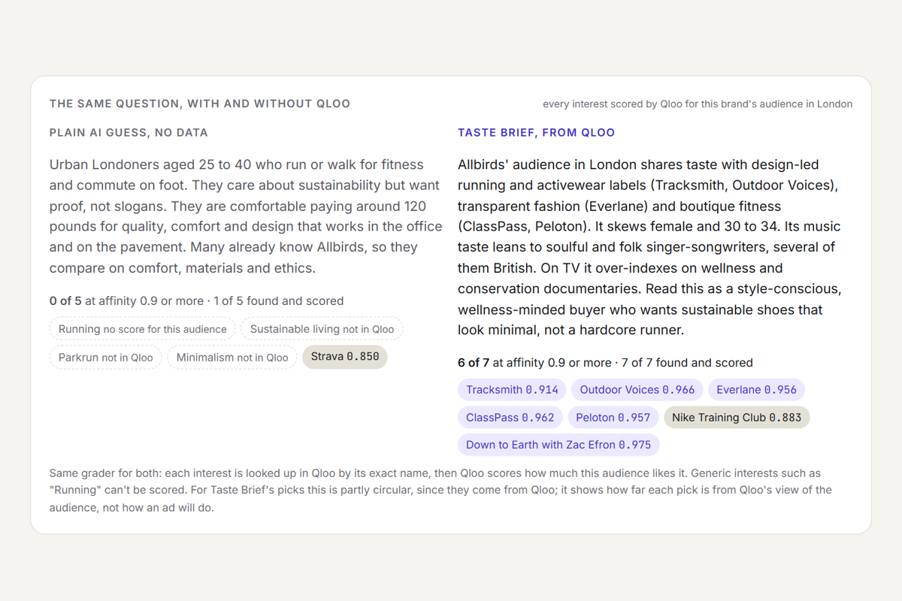
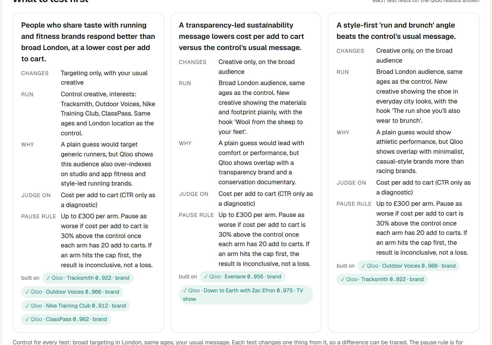
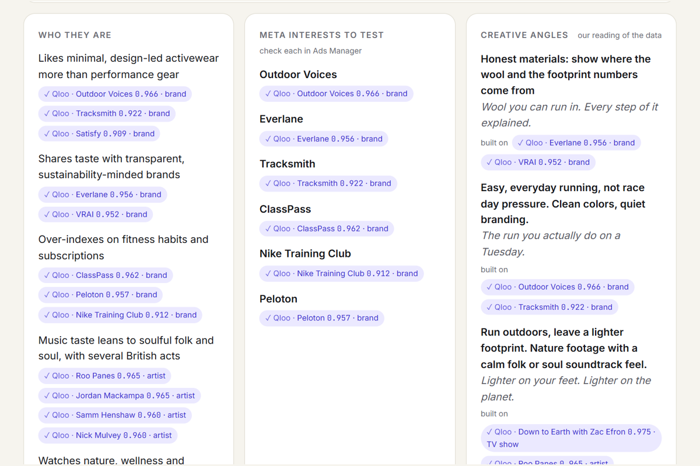
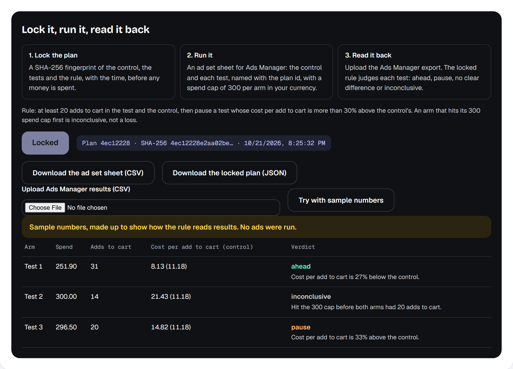

# Taste Brief

A sponsorship decision desk for a media buyer: Qloo finds up to three podcast partners by taste, then Taste Brief
requests the missing terms and compares offers under a single-show pilot budget and target-market CPM cap. The
agent resolves seed entities, reads podcast evidence, chooses shows and drafts the outreach. Deterministic checks
enforce exclusions; the quote desk shows minimum commitments, fees, delivery uncertainty and the price at which a
choice changes.
Quote inputs stay in the browser and can be saved with a decision memo. A separate opt-in scenario is always labelled.

The default podcast workflow finishes after checked drafts. Full analysis is optional: cross-domain taste, Meta
interest verification, creative and a locked test plan. Existing citation and exact-copy review gates still apply.
The historical study below tests Qloo against outside sponsorship labels, not campaign profitability.

27 October local validation: **136 tests**, quote scenarios on three recorded runs, and fresh podcast runs in
**31 / 33 / 36 seconds** in the latest requested round. Earlier 35 / 29 / 49-second attempts remain. The first turntable run was rejected after source review caught an ended show; its rerun
passed correctness but missed the 45-second timing target. See [all attempts](docs/podcast-focus-results.json),
[decision logic and browser QA](docs/decision-desk.md), and [scenario results](docs/decision-desk-results.json).
These changes are local until publication; the old online demo/video may differ.

Built for the [Qloo Agentic Hackathon](https://qloo.devpost.com/).

## Does Qloo pick the podcasts brands sponsor?

The answer key is observed sponsor reads that podcasts publish in their own episode notes (public RSS), never
shown to Qloo. Hypotheses were locked and pushed before any held-out show was read
([docs/podcast-check/PREREGISTRATION.md](docs/podcast-check/PREREGISTRATION.md); check the fingerprints on any OS with
`python scripts/podcast/verify_lock.py`). With the strict sponsor label declared before analysis (82 of 100 matches are
sponsor reads, read by Claude and then by a person blind to the per-item labels: the same 82, 15 not, 3 unsure), on 216 held-out US podcasts and 62 brands, Qloo ranked a detected sponsor relationship above an undetected one 65% of the time (AUC 0.647, 95% interval 0.60 to 0.70 resampling brands and shows), against Apple chart rank 0.522, Qloo popularity 0.526 and
ad volume 0.582. With the pre-registered label: 0.663 on 259 shows and 76 brands. The three pre-registered hypotheses pass on
both. Exploratory checks, not pre-registered ([robustness.json](docs/podcast-check/robustness.json),
[recency.json](docs/podcast-check/recency.json)): the brand's own Qloo score beats other brands' scores on the same shows
(0.65 against 0.57), Qloo is ahead of the chart in all 12 genres (0.62 against 0.55 within genre), it holds for the most recent deals (0.62 against 0.45, 43 placements, suggestive only), and counting only sponsorships whose notes carry the brand's own web
address (84% of them) Qloo still scores 0.64 against 0.52 ([confirmed.json](docs/podcast-check/confirmed.json)). In the top 10,
Qloo plus ad volume (the H3 combination, which the app uses to order podcasts) finds 1.9 sponsored shows on average
against 1.6 for either alone (an exploratory count). Among open shows, where no brand of the category had advertised yet,
Qloo pointed to the one the category moved into next with AUC 0.58 across 12 categories (0.48 to 0.67), against 0.50 for
ad volume and 0.42 for the chart: not conclusive, and mostly apparel ([open-shows.json](docs/podcast-check/open-shows.json)).
A prospective check is locked: Qloo's ranks were frozen on 21 Oct 2026 and sponsorships in
later episodes are read on 29 or 30 Oct ([PREREGISTRATION-2.md](docs/podcast-check/PREREGISTRATION-2.md)). Details and
scripts: [docs/podcast-check](docs/podcast-check/), [scripts/podcast](scripts/podcast/).

A second set of benchmarks is graded by Qloo itself on a held-out competitor's audience (61% of Taste Brief's interests
score 0.9+ against 20% for the same model without data), by Meta's interest list (35% targetable and 0.9+ against 13%)
and by a negative control (86 of 139 picks at 0.9+ on the right competitor against 37 on an unrelated brand). Details in
[docs/benchmark](docs/benchmark/README.md).

## How it works
- `src/agent.js`: tool-using agent loop on Claude. Tools: `search`, `insights`, `demographics`, `tags`, and
  `submit_brief` for the initial result (including `test_plan`, product `category` and up to three `holdout_rival`s), and
  `revise_interests` to correct only interests and tests. The agent looks up tags for the product category and passes them next to the brand, so the brief
  reflects the product too. Every item must cite the Qloo `entity_id`s it rests on.
- `src/outreach.js`: behind the agent's `draft_outreach` tool (the agent picks the shows from its own `podcasts` call,
  which gives it the facts and not the page's rule; `askFirst` in `public/rank.js` is the fallback and the comparison
  the page shows), one more Claude call writes a rate request email and a host-read script for each, from the run's results and the
  product facts typed; unknowns stay in [brackets]; nothing is sent.
- `src/selfcheck.js`: the agent's self-check. Its first brief's Meta interests are scored by Qloo on the audience of a
  rival it named but did not use; a pick below 0.8, or one Qloo cannot score there, goes back to the agent once to replace
  or drop, and both rounds are shown.
- `src/evidence.js`: the evidence gate. A claim counts as grounded only when the entity ids it cites were returned by a
  Qloo call in the same run; the seed entity grounds only claims about itself, or an age/gender claim whose numbers are
  Qloo's demographics for that seed; affinity numbers quoted in the text must match what Qloo returned; one Meta interest
  per line. The page shows the verified Qloo results (name, affinity, type) next to each line, and flags the rest. This
  proves where a line comes from, not that the marketing idea is right. `unbackedBy` lists what the no-data baseline would
  target that Qloo returned nowhere in the run.
- `src/meta.js`: Meta Marketing API interest search, the check that doesn't use Qloo (`scripts/benchmark-meta.mjs`).
- `src/receipt.js`: server receipts for locked plans (`POST /api/lock`, `GET /api/lock/<sha256>`), kept in KV with the server's
  time and not replaced later (KV has no conditional write, so this is consistency checking, not a notary); real results
  get verdicts only when the receipt matches.
- `public/verdict.js`: lock the test plan (SHA-256 of the control, tests and rule, with a timestamp), write the planning
  sheet named with the plan id, and read an Ads Manager export back with the locked rule. Pure functions, no model.
  Targeting tests carry explicit selected entity IDs and verified Meta IDs; unavailable or unchecked targets stay out
  of the lock. The page, Markdown and CSV share that check. Loading a saved plan restores that plan's targets, market
  and rule for exports, even when the current brief differs. Older v1 receipts remain readable; targeting without a
  verified target list cannot be exported as ready. New v3 plans store explicit creative copy and a review tied to that exact text/product; edits invalidate it. The model cannot supply buyer approval, and a hypothesis is never substituted for ad copy.
- `src/podcasts.js`: podcasts ranked by Qloo for the brand with `feature.explainability`, plus the advertisers each
  show's episode notes already run (`src/data/podcast-sponsors.json`, 662 shows) and which of them are in the product's
  category (`src/data/categories.json`), so the page can mark observed category sponsor mentions; unknown coverage stays unknown. `public/rank.js` orders shows by taste
  plus ad count; open shows by taste alone.
- `src/grade.js`: one grader for any list of picks: exact name lookup in Qloo, then the affinity Qloo gives that
  entity for the brand's audience in the market (`filter.results.entities`). Used by the page and the benchmark.
- `src/markets.js`: the second market, without a model in between. Places use `filter.location.query`, so each list is
  real places in that city. Brands, artists and TV use the same insights call per city; the city only nudges Qloo's
  ranking, so the top 12 of each list are compared (only in A, only in B, in both).
- `src/qloo.js`: Qloo client for `https://hackathon.api.qloo.com` (GET + `X-Api-Key`), trims verbose fields, keeps at
  most two requests in flight, retries HTTP 429 with backoff, times out hung calls.
  `src/provider-integrity.js` rejects missing/nil or colliding entity identities before they can support a live brief.
- `public/data/podcast-contacts.js`: dated official contact routes, with source links and separate advertising/general
  labels, plus separate publishing-status sources. Confirmed archival shows are excluded from new host-read outreach; unknown activity stays unknown. `public/buyer-decision.js` derives each next action and the questions to resolve. These do not change the locked sponsorship dataset or imply rates, reach, inventory or exclusivity.
- `src/llm.js`: Claude adapter (Messages API tool use) and a scripted stand-in model for tests and synthetic mode.
- `src/mock-qloo.js`: synthetic data with the same shapes. No real Qloo responses are stored here (Qloo's terms).
- `src/worker.js` + `public/`: Cloudflare Worker serving the page and `POST /api/brief`. The agent and a no-data baseline
  (same question, no Qloo) run side by side; every step is streamed to the page as NDJSON while it happens.
  A provisional `shortlist` event makes the podcast plan available after its drafts pass their checks, while Meta and
  comparisons finish. A later failed run removes the provisional result. The final run records `shortlist_seconds`
  separately from total time; this changes time to the primary result, not necessarily total calls or compute.

`public/draft-checks.js` shares finite draft checks between model feedback, UI, Markdown and copy eligibility. A failed draft stays visible for editing with a reason; passing is not full factual verification.

## Live demo
https://taste-brief.thelongmarketing.workers.dev (Cloudflare Worker). **See a recorded live run now** shows the last real run
of the page's example instantly (kept in KV, only for that exact example, never for what a visitor types). A live run calls Qloo and Claude, so the public
page allows 25 free live runs a day, shared by all visitors, no code needed; an access code (not published) allows more. When neither applies the page runs on synthetic data and says so in a banner.






## Run
Requires Node 20 or newer.
```bash
npm test                          # the full offline test suite, no network
node scripts/evidence-gate.mjs    # agent end to end on synthetic data; fails if any claim is unsupported
npm run preview                   # loopback Node preview, synthetic, no Cloudflare login or deployment
npm run dev                       # local Worker on synthetic data (MOCK=1)
```
Real run: create `.dev.vars` (git-ignored) with `ANTHROPIC_API_KEY=...` and `QLOO_API_KEY=...`, then either
`npm run live -- "Wool running sneakers, $120" "London, UK" "Allbirds"` (command line, result in `.results/`) or
`npx wrangler dev --var MOCK:0`. `GATE_LIVE=1 node scripts/evidence-gate.mjs` runs the evidence gate on live data.
`npm run preview -- --live` uses the existing ignored `.dev.vars` for real provider calls, with memory-only local
receipts and quota. It binds to `127.0.0.1:8791`; set `PORT` to use another port. It never writes production KV.
Deploy: `npx wrangler secret put` for both keys (and `DEMO_CODE` for the access code), create a KV namespace for the
daily free-run counter (`npx wrangler kv namespace create QUOTA`, id into `wrangler.jsonc`), then `npm run deploy`.
Keys stay server-side; never commit them.

## Blind check
`docs/blind-check/` holds a blind comparison of a Qloo plan and a plain AI plan from the same live run, judged by ChatGPT and
Claude in both orders, with the prompts and every answer. Result in short: 3 of 4 would fund the plain runner plan first,
all 4 rated the Qloo plan more distinctive and all 4 picked one of its tests to run first. The test plan now always runs
against the obvious ad set as the control.

## CI on GitLab
The repository also carries a GitLab pipeline: `.gitlab-ci.yml` runs the unit tests and the evidence gate (report as an
artifact), secret detection, dependency scanning and SAST, deploys the Worker from the default branch and smoke-tests the
live URL. `.gitlab/duo/flows/` holds two GitLab Duo flows: an MR reviewer that flags changes that could let an unsupported
claim through, and a pipeline-failure triage that never lowers the evidence threshold or deletes tests.

## Limitations
- Qloo describes aggregate taste affinities of groups, not purchases and not what any one person will do; a brief is a
  hypothesis to test with ads, not a forecast.
- Qloo's demographics are for the seed entities and are not location-specific; the market comparison uses insights.
- Creative angles, the landing page, the summary and the test plan are the model's interpretation of the cited results,
  and are labelled so.
- The city comparison looks at each city's top 12; a name missing from one top 12 may still rank lower there.
- Each interest is looked up in Meta's interest search inside the agent's self-check (`src/meta.js`, needs `META_ACCESS_TOKEN`, search only, no ad account); a missing one goes back to the agent once to be replaced. A targeting test with missing, unknown or failed checks is held out of the saved plan (`docs/meta-loop/`). Meta's audience sizes are worldwide.
- When Qloo returns a wrong match (e.g. a magazine for a shoe brand) the agent is told to skip it and say so; it may miss.

The local follow-up checked on 27 October passed 121 tests. The latest passing local QA result for each of three declared cases produced draft-ready shortlists at 44, 35 and 36 seconds, and full results at 101, 103 and 96 seconds. Coffee was rerun after a citation-feedback fix; the preceding 99-second coffee result retained a flagged audience claim. All attempts are retained. These observations meet the declared 45/120-second targets but are not a latency guarantee or a buyer outcome. See [the QA record](docs/qa-round2-results.json) for failures and scope.

Built by a marketer with AI coding assistance (Claude Code and Codex). Local validation and its limits: [26 October record](docs/validation-2026-10-26.md). License: MIT.
