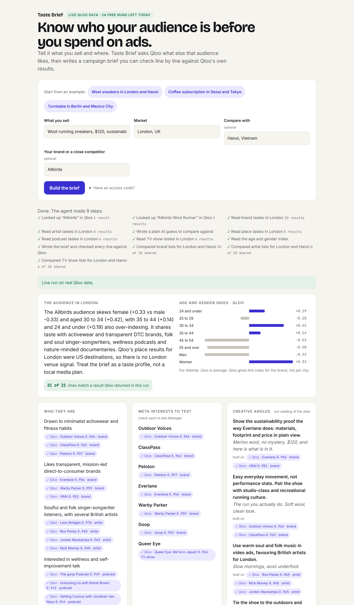
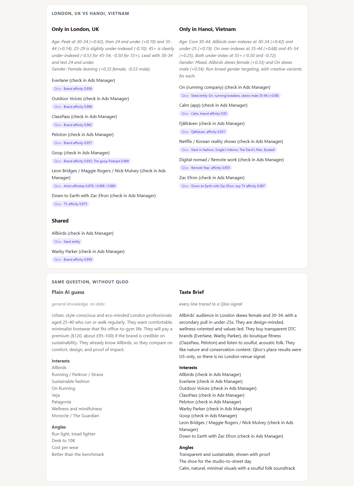

# Taste Brief

An agent for performance marketers. Give it a product and a market; it asks Qloo's taste graph who really buys it,
what else they love (brands, artists, shows, podcasts, places) and how old they are, then writes an audience and
creative brief: audience portrait, Meta Ads interests, creative angles, a landing-page headline and partnership ideas.
Every line carries the Qloo signal it came from, so the brief can be checked instead of trusted.

Built for the [Qloo Agentic Hackathon](https://qloo.devpost.com/) and shipped with GitLab CI/CD and Duo Agent Platform
flows for [Life After Code](https://gitlab-transcend.devpost.com/).

## How it works
- `src/agent.js`: tool-using agent loop. Tools: `search`, `insights`, `demographics`, `tags`, and `submit_brief`
  (the only way to finish; its schema forces evidence on every item). Returns the brief plus the names Qloo returned.
- `src/evidence.js`: the evidence gate. A claim is grounded only if its evidence names something the tools returned.
- `src/qloo.js`: Qloo client for `https://hackathon.api.qloo.com` (GET + `X-Api-Key`), trims verbose fields.
- `src/llm.js`: Claude adapter (Messages API tool use) and a scripted mock model.
- `src/mock-qloo.js`: synthetic data with the same shapes. No real Qloo responses are stored here (Qloo's terms).
- `src/worker.js` + `public/`: Cloudflare Worker serving the page and `POST /api/brief`; a no-data baseline and a
  second market run in parallel for comparison.

## Live demo
https://taste-brief.thelongmarketing.workers.dev (Cloudflare Worker). Live Qloo + Claude calls need the access code given
to judges in the submission, so a public page cannot run up API costs; without it the page runs on clearly labelled
synthetic data. A link with `?code=...` fills the code in.




## Run
```bash
npm test                          # 16 tests, no network
node scripts/evidence-gate.mjs    # agent end to end on synthetic data; fails if any claim is unsupported
npm run dev                       # local Worker on synthetic data (MOCK=1)
```
Real run: create `.dev.vars` (git-ignored) with `ANTHROPIC_API_KEY=...` and `QLOO_API_KEY=...`, then either
`npm run live -- "Wool running sneakers, $120" "London, UK" "Allbirds"` (command line, result in `.results/`) or
`npx wrangler dev --var MOCK:0`. `GATE_LIVE=1 node scripts/evidence-gate.mjs` runs the evidence gate on live data.
Deploy: `npx wrangler secret put` for both keys (and `DEMO_CODE` to require an access code), then `npm run deploy`.
Keys stay server-side; never commit them.

## Post-code automation (GitLab)
- `.gitlab-ci.yml`: verify (unit tests, evidence gate with `evidence-report.json` artifact) → secure (secret detection,
  dependency scanning, SAST) → release (Worker deploy from the default branch) → monitor (smoke test of the live URL).
- `.gitlab/duo/flows/evidence-review.yml`: Duo flow assigned as MR reviewer; flags changes that could let an
  unsupported claim through and posts one verdict note.
- `.gitlab/duo/flows/pipeline-triage.yml`: Duo flow on a failed pipeline; fixes code on a branch and opens an MR, never
  lowers the evidence threshold or deletes tests; opens an incident issue for deploy or live failures.

## Limitations
- Qloo describes aggregate affinities of groups, not what one person will do; a brief is a hypothesis to test with ads.
- The gate checks that evidence names a real Qloo result, not that the number quoted next to it is right.
- Interest names must be checked in Meta Ads Manager before use.

Built by a marketer with AI coding assistance (Claude Code); every change reviewed and tested. License: MIT.
